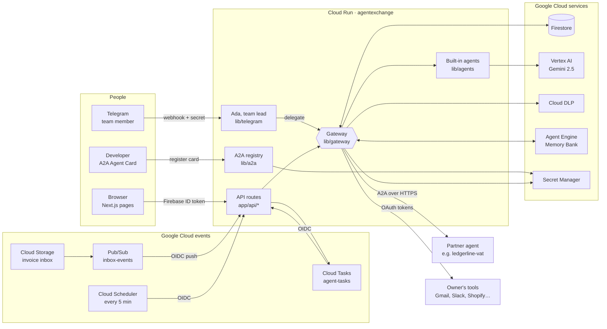
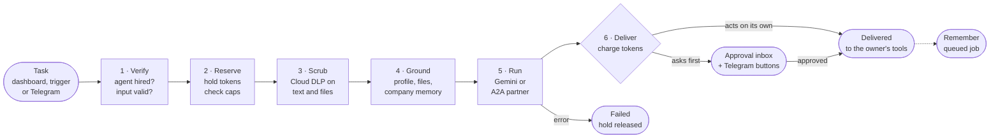
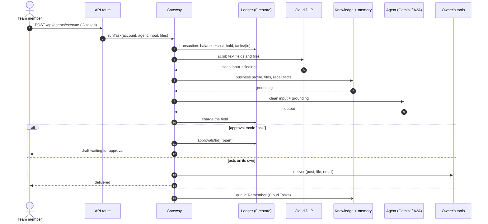
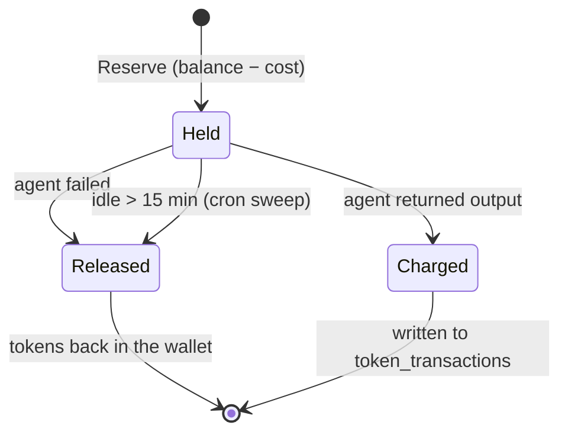
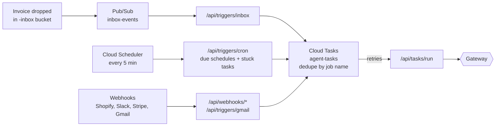
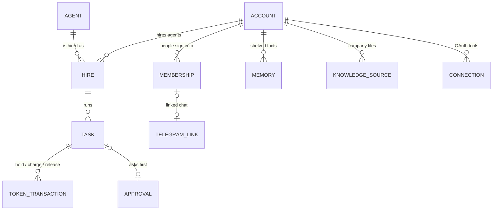
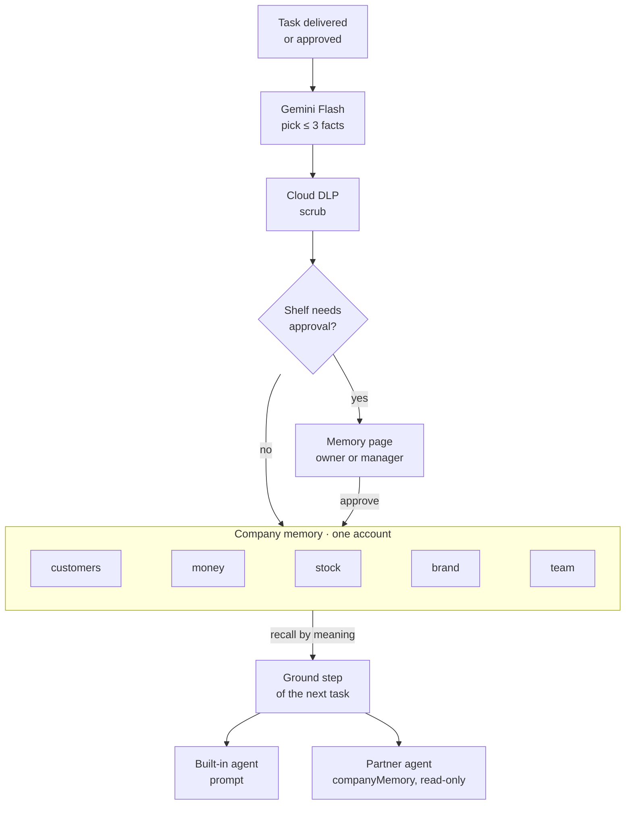
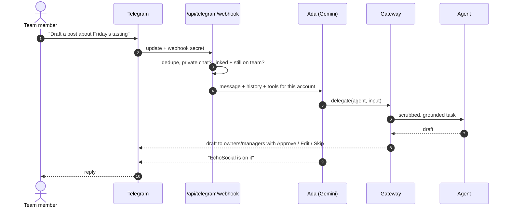

# AgentGig

An AI agent marketplace for businesses and teams, built on Google Cloud for the AI Builder Cup 2026. Teams hire AI employees, pay per finished task in tokens, and approve anything that goes public. Developers list their own agents by publishing an A2A Agent Card.

## Stack

Next.js 15 (App Router) · Tailwind v4 · shadcn/ui · Firestore · Vertex AI (Gemini 2.5 via `@google/genai`) · Cloud DLP · Cloud Run · A2A protocol v0.3

## Architecture



The browser reads its own Firestore documents directly; every write and every agent run goes through the API and the gateway.

## Run locally

```bash
cp .env.example .env.local        # fill in GOOGLE_CLOUD_PROJECT and the Firebase web config
gcloud auth application-default login
npm install
npm run seed                      # loads the agent catalogue and the Café Lumen demo account
npm run deploy:rules              # publishes firestore.rules
npm run dev
```

`npm run seed -- --reset` puts the demo account back to 312 tokens and clears its tasks.

Open http://localhost:3000 and click **Try the demo**: you get a private copy of the Café Lumen sandbox (anonymous sign-in, 312 tokens, EchoSocial and ReceiptHero hired). Email/password accounts start with 100 tokens and an empty team.

## Pages

| Page | What it does |
|---|---|
| `/` | Home: what AgentGig is, an example day, how the gateway protects data |
| `/marketplace` | Browse and hire agents (connect tools, choose when it works, approval mode, what it can see) |
| `/workforce` | Approval inbox, your team, run a task with a live gateway console, results, token history |
| `/memory` | Company memory: facts agents shared with each other, approvals for sensitive shelves, add, pin, edit or forget |
| `/knowledge` | Business profile and company files agents can be given |
| `/team` | Invite people by link, roles (owner, manager, member), memory settings |
| `/join/{token}` | Accept an invite link |
| `/developers` | Register an A2A agent: card checks, test task, listing |


## Checks

```bash
npm test               # unit tests: ReceiptHero audit maths, local DLP scrubbing
npm run test:ledger    # 20 concurrent tasks vs a 10-token balance, against real Firestore
npm run smoke          # API end-to-end against `npm run dev` (needs DEMO_AUTH=true)
npm run e2e            # browser end-to-end with Playwright; screenshots in e2e-shots/
```

Run a task by hand (with `DEMO_AUTH=true`):

```bash
curl -X POST localhost:3000/api/agents/execute -H "x-demo-user: demo-cafe-lumen" \
  -H "content-type: application/json" \
  -d '{"agentId":"echosocial","input":{"brandUrl":"https://cafelumen.co.uk","audience":"Office managers in Manchester","tone":"Friendly"}}'

curl -X POST localhost:3000/api/agents/execute -H "x-demo-user: demo-cafe-lumen" \
  -F agentId=receipthero -F file=@fixtures/invoice-lumen-supplies.pdf
```

## Layout

```
app/                 pages and API routes
lib/                 server code: env, Firebase Admin, ledger, Vertex AI, DLP, gateway, agents
types/a2a.ts         A2A Agent Card (Zod schema) and message/task types
types/firestore.ts   one interface per Firestore collection
data/agents.ts       launch catalogue and demo account
scripts/seed.ts      Firestore seed
firestore.rules      clients read their own docs; all writes go through the API
```

## How a task runs

Every task goes through one gateway: **Verify → Reserve tokens → Scrub personal data → Ground with company knowledge → Run agent → Deliver and charge.** Tokens are held before the agent runs and charged only when it returns output, so failed tasks cost nothing. Agents never act on the owner's tools directly; the gateway does, using OAuth tokens kept in Secret Manager.



Each step is appended to `tasks/{id}.steps`, which the Workforce page's live console shows as it happens.

### Data flow for one task



### Token ledger



Reserve runs in a Firestore transaction, so 20 concurrent tasks against a 10-token balance can't overspend (`npm run test:ledger`).

### Triggers



Every internal hop carries a Google-signed OIDC token for the app's service account.

## Teams and company memory



An account is an organization: one wallet, one business profile, one team of agents. Its ID is the owner's uid, and every collection's `userId` field holds that account ID. Teammates sign in with their own login; `memberships/{uid}` points them at the account with a role (`lib/org.ts`). Owners buy tokens and manage people, managers hire agents, approve drafts and edit memory, members run tasks.

Agents share what they learn through **company memory** (`lib/memory`), split into five shelves: customers, money, stock, brand, team. Each hire chooses which shelves the agent reads and adds to; partner (A2A) agents only read.

- **Recall** (in Ground): facts from the agent's read shelves go into its prompt, or into the A2A message as `companyMemory`.
- **Remember** (queued after Deliver, or after the owner approves): Gemini Flash picks out at most 3 facts the other agents should know, Cloud DLP scrubs them, and they are saved. Facts for shelves in the approval list wait on the Memory page.



Facts live in Firestore `memory/{id}`. With `MEMORY_ENGINE` set, Vertex AI Agent Engine Memory Bank also stores them under the scope `{ account_id, shelf }`, finds the relevant ones for each task by meaning, and merges updates with existing facts. Firestore mirrors it under the same IDs.

## Telegram

Every team member can talk to their organization's team lead, **Ada**, from Telegram through one shared AgentGig bot (`lib/telegram`).

- **Linking:** Team page → Connect my Telegram makes a one-time `t.me/<bot>?start=<code>` link (10 minutes; only its SHA-256 is stored). The webhook redeems it for whoever sends `/start <code>` and writes `telegram_links/{uid}`.
- **Who's talking:** every update must carry the webhook secret, is handled once (`telegram_updates`), must come from a private chat, and its sender's Telegram ID must map to a link whose person is still on that team. Strangers get a generic reply that says nothing about any business.
- **Ada** is one stateless Gemini call per message with function calling (`delegate`, `approvals`, `decide_approval`, `remember`, `company_memory`, `status`). Her instructions, history (`telegram_chats/{accountId}_{uid}`) and tools come from the sender's own account; the account ID is never a model argument. Delegated work runs through the normal gateway, and the agent posts its result under its own name.
- **Roles still apply:** members give tasks and ask questions; owners and managers also approve (inline buttons) and add memory. Drafts made anywhere are sent to linked owners and managers with Approve / Edit / Skip.



Setup: create the bot with @BotFather, put `TELEGRAM_BOT_TOKEN`, `TELEGRAM_BOT_USERNAME` and a random `TELEGRAM_WEBHOOK_SECRET` in `.env.local` and on Cloud Run, then `npm run telegram:setup`.

## Deployment (Google Cloud project `agentexchange-hackathon`)

Live app: https://agentgig.si (Cloud Run: https://agentexchange-653235000565.us-central1.run.app)

| Piece | What it is |
|---|---|
| Cloud Run `agentexchange` | This app (Dockerfile, Next.js standalone), service account `agentexchange-app` |
| Cloud Run `ledgerline-vat` | Sample partner A2A agent (`partners/ledgerline`), its own service account and API key |
| Firestore `(default)` | Users, agents, hires, tasks, token ledger, approvals, knowledge |
| Cloud Storage | `-knowledge` (company files), `-inbox` (invoice inbox, 1-day lifecycle) |
| Pub/Sub `inbox-events` → push `/api/triggers/inbox` | New inbox files start ReceiptHero |
| Cloud Scheduler `agent-schedules` → `/api/triggers/cron` | Every 5 minutes; queues scheduled agents that are due |
| Cloud Tasks `agent-tasks` → `/api/tasks/run` | Runs triggered jobs with retries; deterministic job names dedupe events |
| Secret Manager | Partner API keys |

Internal endpoints accept only Google-signed OIDC tokens for the app's service account.

**Deploys are automatic:** every push to `main` of [SherefAbolmagd/agentgig](https://github.com/SherefAbolmagd/agentgig) that passes CI is deployed by the `deploy` job in `.github/workflows/ci.yml`. It signs in without keys through Workload Identity Federation (pool `github`, provider `agentgig`, limited to `main` of this repo) as the `github-deployer` service account. Firestore rules are not part of it; publish them with `npm run deploy:rules`. To deploy by hand:

```bash
gcloud run deploy agentexchange --source . --region us-central1 --project agentexchange-hackathon
```

## Production notes

### What is real and what is simulated

| Real | Simulated for the hackathon |
|---|---|
| Token ledger, holds, charges, refunds, spending caps | Payment for top-ups (no card is charged; capped at 3 a day per user) |
| Gemini 2.5 on Vertex AI, Cloud DLP scrubbing | Posting to LinkedIn, filing to Drive, emailing suppliers |
| A2A registry and partner calls over HTTPS | OAuth connections to third-party tools |
| Schedules, invoice inbox, Cloud Tasks retries | |

### Security model

- Every API route requires a Firebase ID token. `DEMO_AUTH` (header login for local testing) refuses to start on Cloud Run.
- Clients can only read their own Firestore documents; all writes go through the API with the Admin SDK.
- Personal data is removed with Cloud DLP before any agent sees text; partners never receive OAuth tokens or uploaded knowledge files.
- Outbound calls to developer-supplied URLs are HTTPS-only, refuse private/link-local addresses and don't follow redirects (SSRF guard).
- Internal endpoints (`/api/triggers/*`, `/api/tasks/run`) accept only Google-signed OIDC tokens for the app's service account.
- Service accounts are least-privilege; partner API keys live in Secret Manager (custom role `partnerKeyManager`).
- Security headers and a Content Security Policy on every page; `npm audit` clean for production dependencies.

### Limits and cost controls

Rate limits (Firestore counters with TTL): 30 new demo sandboxes per IP per hour and 500 per day overall; 40 tasks per user per 10 minutes; 40 uploads per user per hour; 10 agent registrations per developer per hour; 3 demo top-ups per user per day. Per-agent monthly token caps are set by owners. Demo sandboxes are deleted after 7 days.

### Operations runbook

| Situation | What to do |
|---|---|
| Errors | Cloud Logging, filter `severity>=ERROR` on service `agentexchange`; stack traces also appear in Error Reporting |
| Trigger problems | Logs with `jsonPayload.component="triggers"` show each inbox event and job phase; `gcloud tasks list --queue agent-tasks --location us-central1` shows retries |
| A task looks stuck | The 5-minute cron returns held tokens for tasks idle over 15 minutes |
| Rotate a partner's API key | The developer re-registers with the new key in `/developers`; it's stored as a new secret version |
| Remove a user's data | They use "Delete my account", or call `deleteAccount(uid)` from `lib/accounts.ts` |
| Health | `GET /api/health`; an uptime check watches it |
| Local development | One environment: `npm run dev` uses the same Firestore `(default)` database, buckets and Memory Bank as production, so local actions change live data. `DEMO_AUTH=true` only ever works locally |

Checks: `npm run verify` (typecheck, lint, unit tests), `npm run test:ledger` (makes and removes its own throwaway account), `npm run e2e` (browser), all run before each deploy. `npm run test:ops` runs the cleanup jobs for real, so it refuses the production database; point `FIRESTORE_DATABASE_ID` at a scratch database to run it.
